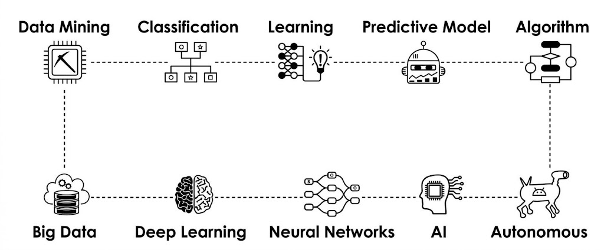

 

# AI & Machine Learning Portfolio

### BinX Tech Training Journey

  
  
  

**A practical learning journey in Artificial Intelligence, Machine Learning, and data-driven development.**

[ BinX-Training-AI-ML](https://github.com/Shimaa-Habes/BinX-Training-AI-ML) · [ LinkedIn Profile](https://www.linkedin.com/in/shimaa-habes/)

---

## 👩‍💻 About Me

I'm a **Junior Full-Stack Developer** with a growing focus on **Artificial Intelligence and Machine Learning**.

Through my training journey with **BinX Tech**, I strengthened my Python skills, explored machine learning workflows, and gained practical experience with tools used in data science and AI development.

This repository represents my learning progress, coding practice, and continued commitment to developing practical technical skills.

🎓 **Training Status:** Completed  
🏢 **Training Organization:** BinX Tech  
🧠 **Areas of Interest:** Artificial Intelligence, Machine Learning, Data Science, and AI-powered applications

## 🎯 Learning Areas

<table>
<tr>
<td width="50%">

### 🐍 Python & Data Science

- Python programming
- Data manipulation
- Exploratory data analysis
- Data visualization

</td>
<td width="50%">

### 🤖 Machine Learning

- Machine learning workflows
- Data preprocessing
- Model training concepts
- Model evaluation

</td>
</tr>
<tr>
<td width="50%">

### 🧠 Deep Learning

- Neural network fundamentals
- Deep learning concepts
- Training and validation workflows

</td>
<td width="50%">

### 🔍 Model Understanding

- Evaluation metrics
- Model interpretation concepts
- Experiment organization
- Reproducible workflows

</td>
</tr>
</table>

## 🛠️ Tech Stack

### Languages & Data Tools

### Machine Learning & Development

### Developer Tools

## 📂 Repository Structure

The repository is organized into weekly training work, datasets, presentation media, and the final project.

| Directory / File            | Description                                       |
| --------------------------- | ------------------------------------------------- |
| `BinX-Week1` – `BinX-Week9` | Weekly training exercises and practical work      |
| `CardiacML-Project`         | Dedicated CardiacML project folder                |
| `Datasets`                  | Datasets used throughout the training work        |
| `Media`                     | Images and visual assets used in the presentation |
| `Final-Project`             | The final **ScaleFlow** project                   |
| `requirements.txt`          | Python dependencies required for the environment  |

## 💡 What This Journey Represents

- 📊 Applying programming skills to data-focused tasks.
- ⚙️ Exploring the stages of a machine learning workflow.
- 🧪 Practicing with Python libraries and development environments.
- 📈 Building a foundation for understanding model evaluation.
- 🚀 Exploring how AI/ML can support real-world software applications.

## 🌱 What's Next?

Learning doesn't stop at completing a training program.

My next step is to keep strengthening my AI/ML knowledge and explore ways to integrate intelligent, data-driven features into practical applications.

I'm especially interested in the intersection of **AI/ML and Full-Stack Development** — turning technical concepts into useful software solutions.

## 🔐 Repository Disclaimer

This repository serves as a personal learning portfolio. It is not intended to redistribute proprietary training materials, confidential information, restricted program resources, or datasets that are not approved for public release.

Please respect the ownership, privacy, and usage terms associated with all training-related resources.

## 🤝 Let's Connect

I'm always interested in learning, collaborating, and connecting with people working in software development, Artificial Intelligence, and Machine Learning.

- 💻 **GitHub:** [Shimaa-Habes](https://github.com/Shimaa-Habes)
- 📁 **Project Repository:** [BinX-Training-AI-ML](https://github.com/Shimaa-Habes/BinX-Training-AI-ML)

---

### ✨ Learn Continuously. Build Intentionally. Grow Consistently.

_Every project is another step forward._

